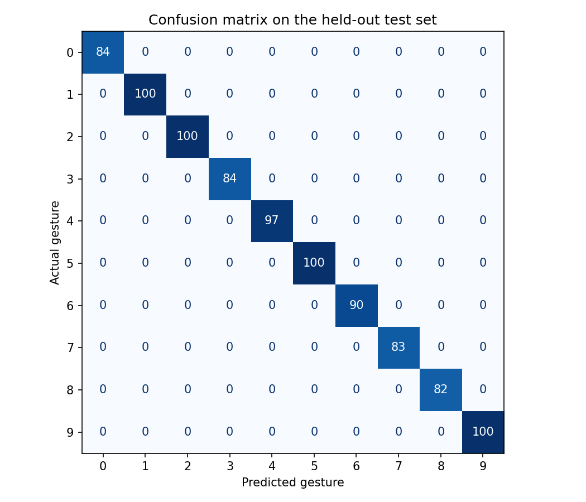

# Computer Vision Mouse Control

Control the mouse with your hand in front of a webcam. MediaPipe tracks the hand, a k-nearest-neighbours classifier trained on American Sign Language digits recognises gestures, and PyAutoGUI moves the cursor and presses keys.

## Gestures

| Gesture | Action | On by default |
| --- | --- | --- |
| Move your hand | Move the cursor | yes |
| Pinch thumb and index finger | Left click. Keep pinching to drag. | yes |
| Peace sign (ASL 2), held for half a second | Show desktop (`Win + D`) | yes |
| Point with the index finger (ASL 1), held for 0.6 seconds | Press `Esc` | no |

The camera view and the controls share one window. Every control is a large single-click button, with no sliders or small checkboxes, so the panel can be operated with the hand-driven cursor itself. From it you can switch each gesture on or off, choose how much the cursor is smoothed, and pause hand control. The status line under the title shows what the program currently sees (for example "Point (digit 1)"), which is the quickest way to check whether a gesture is being recognised.

`Esc` goes to whichever window has the keyboard focus, so the point gesture closes Hand Mouse only when its own window is focused.

## Setup

You need Python 3.10 or newer and a webcam.

```
git clone https://github.com/bekkaayele/Computer-Vision-Mouse-Control.git
cd Computer-Vision-Mouse-Control
pip install -r requirements.txt
python hand_mouse.py
```

The first run downloads MediaPipe's hand model (about 8 MB) next to the script. The gesture classifier is trained from the CSV each time the program starts, which takes well under a second, so there is no model file to keep in sync.

To quit, press `Esc`, click Quit, or close the window. Moving the real mouse into a corner of the screen also stops the program (PyAutoGUI's fail-safe). Use `python hand_mouse.py --camera 1` to pick another webcam.

The mouse and `Esc` actions work on any system PyAutoGUI supports. The show-desktop shortcut is the Windows one.

## How it works

1. **Hand tracking.** MediaPipe's hand landmarker returns 21 landmarks for one hand in each mirrored camera frame.
2. **Cursor.** The cursor follows the knuckle at the base of the middle finger, which stays still while the fingers pinch or form a gesture. The central 60% of the frame is mapped to the whole screen, so the edges can be reached without the hand leaving the picture, and the position is exponentially smoothed to remove jitter.
3. **Pinch.** The distance between thumb tip and index tip is divided by the palm length, so the same threshold works at any distance from the camera. Separate press and release thresholds stop the click from flickering. The cursor is frozen for the first quarter of a second of a pinch so a quick pinch is a clean click.
4. **Gesture classification.** The landmarks are moved so the wrist is at the origin, scaled by the palm length and rotated so the palm points up, which makes the features independent of where the hand is, how large it appears and how it is tilted. A 5-nearest-neighbours classifier predicts the ASL digit. A pose that is far from all of its neighbours is answered with "unknown" instead of being forced into a digit.
5. **Triggering.** A gesture has to be held before its action fires, and it fires once per hold. Gaps of up to a quarter of a second are ignored, because recognition flickers on real camera frames.
6. **Threads.** A background thread reads the camera and drives the mouse; the main thread only runs the window. Hand control therefore keeps working while the window is minimised, for example after the show-desktop gesture.

## Model evaluation

```
python evaluate_model.py
```

| Measurement | Result |
| --- | --- |
| Accuracy on a held-out 20% test set | 100% |
| 5-fold cross-validated accuracy | 100% |
| Test accuracy with hands moved, resized and tilted up to 45° | 100% |
| Test accuracy with every landmark nudged by 5% of the palm length | 99.8% |
| Test accuracy on mirrored (other-hand) poses | 100% |
| Digits hidden from training that are rejected as unknown | 45% |

The "unknown" threshold is deliberately loose. A strict threshold rejected 97% of hidden digits, but it also rejected most poses as soon as the landmarks differed slightly from the dataset, so gestures from a real hand were rarely recognised.



The dataset has 5,000 samples, 500 per digit, of which 4,598 remain after removing exact duplicates. Training adds a mirrored copy of every sample so both hands are recognised.

## Limitations

- The dataset looks like consecutive frames of a few recordings, so the training and test sets contain very similar poses and the perfect scores above are optimistic. The model has not been measured on other people's hands.
- Because the "unknown" threshold is loose, a hand pose that is not a digit is often still given the nearest digit.
- Tracking quality drops in poor light or with a low-quality webcam.
- Only two of the ten digits are bound to actions.

## Project structure

```
hand_mouse.py         the application: camera loop, hand tracker, window and controls
mouse_controller.py   cursor mapping, pinch detection, gesture triggering
gesture_model.py      landmark features and the gesture classifier
evaluate_model.py     accuracy report and confusion matrix
data/                 ASL digit landmark dataset (CSV)
tests/                unit tests for everything that does not need a webcam
```

## Tests

```
pytest
```

## Credits

- Dataset: S. M. Rayeed, [American Sign Language Digit Dataset](https://www.kaggle.com/datasets/rayeed045/american-sign-language-digit-dataset), Kaggle, 2021.
- [MediaPipe](https://ai.google.dev/edge/mediapipe/solutions/vision/hand_landmarker) hand landmarker, [OpenCV](https://opencv.org), [PyAutoGUI](https://pyautogui.readthedocs.io), [scikit-learn](https://scikit-learn.org).
